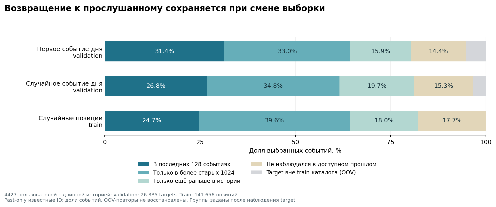

> Historical report from 2026-10-20; research branch closed on 2026-10-21. Any proposed runs or next steps below are historical and cancelled. See the [closure record](../README.md) for the final status.

**Музыкальные рекомендации: что говорят данные и какую задачу исследовать дальше — 20 октября 2026**

Повторные прослушивания — нормальная часть музыкального потребления. Наш сильный personal-frequency baseline сам по себе не доказывает ни ошибку validation, ни неисправность нейросетевого обучения. В предыдущем разборе акцент на слабости ML был слишком сильным: теперь есть и независимые данные, и прямой related work, подтверждающие доменную природу явления. Новые GPU-обучения пока стоит отложить до выбора исследуемого сценария.

Самое сильное новое разделение: **recent128-repeat составляет 51,47% organic targets против 6,22% recommendation-driven targets**. Исходный aggregate смешивал сильно разные режимы потребления. Флаг восстановлен из той же закреплённой версии source для CPU-аудита; это наблюдательный разрез, не рандомизированный causal эффект источника.

Next-item prediction (NIP) — определённая и полезная задача прогнозирования. Она не является универсальной постановкой музыкальных рекомендаций и не измеряет автоматически удовлетворённость. Следующий записанный трек, подходящая подборка и полезное вмешательство рекомендателя — разные цели. Утверждать, что NIP вообще некорректен для музыки, имеющиеся основания не позволяют.

Работа этого разбора: CPU-анализ существующих train/validation, новые фиксированные популярностные контроли, проверка альтернативного выбора validation targets, проверка публичных metadata и чтение первичной литературы. Репозиторий не изменён, GPU не использован, test-метрики не рассчитывались. Это целевой обзор релевантных работ, не систематический обзор всей литературы и не доказательство мировой новизны идей.

**Что уже установлено в наших данных.**

Global popularity рассчитана только по train текущей когорты 4427 пользователей: 89 191 505 событий, каталог 1 049 612 айтемов. Это популярность в когорте, не по всему Yandex Music. Все items, включая знакомые, остаются кандидатами; OOV targets получают ноль.

| Метод на исходной daily-first validation | Macro-user NDCG@10 | NDCG@100 |
|---|---:|---:|
| Global popularity | 0,001928 | 0,005925 |
| Частота в последних 128 событиях | 0,097245 | 0,126156 |
| Давность последнего появления в recent128 | 0,087914 | 0,121033 |
| Частота в видимых 1152 событиях | 0,064115 | 0,105953 |
| FuXi, существующий p60 | 0,024252 | 0,040383 |

Следовательно, главный доступный сигнал — персональные повторения, а не просто общеизвестные хиты. Независимый пересчёт recent-frequency NDCG@10 без global fallback полностью совпал с первым. Ранее проверенные код/ранги не обнаружили ошибки сдвига labels, item mapping, seen filtering или расчёта NDCG; нейросетевые logits не пересчитывались. Нейросетевые модели ещё улучшались на p60, поэтому их результат нельзя считать достигнутым потолком.

Флаг `is_organic` дополнительно восстановлен через чтение только UID/origin колонок source: около 57,45 MB сетевых данных. Полный 4 GB файл не скачивался. Сопоставление основано на том же UID и исходном индексе события (train length + future index), с проверенной provenance, UID, бинарностью flags и длинами параллельных массивов. Предыдущая подготовка уже проверяла точное совпадение item/timestamp train prefixes.

| Origin target на исходной validation | Anchors | Repeat в R128 | Наблюдался в 1152 | Recent-frequency NDCG@10 | FuXi NDCG@10 |
|---|---:|---:|---:|---:|---:|
| Organic | 14 660 | 51,47% | 75,53% | 0,163124 | 0,037202 |
| Recommendation-driven | 11 675 | 6,22% | 50,56% | 0,010786 | 0,007292 |

Repeat fractions — доли anchors; качество — macro-user внутри соответствующего origin. Пользователи групп пересекаются и знаменатели различаются. Отдельные contributions с исходными глобальными знаменателями точно восстанавливают общие NDCG. Organic — 51,00% train events, 50,86% всех validation events и 55,67% daily-first targets.

Сильный personal-repeat результат особенно связан с organic-срезом. По global contributions примерно 98% разрыва FrequencyR128−FuXi NDCG@10 и 95% разрыва FuXi−QSSM2 приходится на organic anchors. Это не позволяет причинно приписать origin весь эффект: группы различаются пользователями, контекстами и items. Также organic не означает ручной выбор каждого конкретного трека, а recommendation-driven не означает успешную или неуспешную рекомендацию. Флаг target используется после предсказания и не является автоматически допустимым входом online router.

Эта проверка поддерживает исследование различий сценариев сильнее, чем общее объяснение «модель не умеет длинную историю». Данные: [origin audit](music-origin-audit.md), [метрики и contributions](../aggregates/music-origin-audit.json), [проекция source](../aggregates/music-origin-fetch-manifest.json).

Для проверки selection effect заранее зафиксирован seed42: по одному равномерному событию для каждого того же пользователя и занятого дня validation. Сохранены 26 335 targets и 4384 пользователя. Контекст состоит только из событий со строго меньшим timestamp. Из-за 5-секундной точности записи предшествующие события с тем же timestamp исключены; target выбирается до catalogue mapping.

| Свойство | Первое событие дня | Случайное событие того же user/day |
|---|---:|---:|
| Уже встречался в recent128 | 31,41% | 26,80% |
| Уже встречался в любом доступном прошлом | 80,32% | 81,26% |
| OOV | 5,32% | 3,40% |
| Перерыв перед target ≥30 минут | 95,87% | 12,22% |
| Медиана перерыва | 14,26 ч | 3 мин |
| Recent-frequency NDCG@10 | 0,097245 | 0,064743 |

Это доли выбранных anchors. Macro-user доли и paired bootstrap отдельно сохранены в JSON. Разница random−first по macro-user recent-repeat составляет −4,36 п.п., 95% CI [−5,09; −3,68]; по any-past-repeat +1,25 п.п., CI [+0,60; +1,91]. Интервалы учитывают ресэмплинг фиксированных пользователей, а не вариацию seed случайного выбора событий.

Первое событие дня действительно меняет задачу: оно почти всегда следует за продолжительным перерывом и сильнее благоприятствует recent-repeat эвристике. Однако **оно не создаёт общую повторяемость из ничего**. На 141 656 случайных train-позициях, до 32 на пользователя, известные повторы составляют 82,27%. Доли any-past-repeat являются нижней границей: OOV identities после mapping в 0 нельзя восстановить. Альтернативная выборка тоже остаётся диагностической, а не единственным правильным стандартом. Старые метрики FuXi на daily-first нельзя сравнивать с эвристиками на random targets.

Важное ограничение переносимости: когорта намеренно отобрана по ≥16K train events. Эти доли не описывают всех пользователей музыки. Равномерный event внутри каждого user/day также не равен выборке, взвешенной по общему объёму событий.

**Recent128 здесь не равен текущей сессии.** Медианный размах последних 128 событий — 37 часов на daily-first и 46,9 часа на random targets. 1152 события охватывают около 16 дней. Перерыв до target в эти размахи не включён. Поэтому разделение «старая история / recent128» — вычислительная граница, а не проверенное разделение долгосрочного вкуса и текущего намерения.

Среди повторных известных targets последняя встреча медианно была 374 события /112,4 часа назад для daily-first и 422 события /141,2 часа назад для random. Всего 5,06% и 3,34% соответствующих targets совпадают с последним доступным событием. Это возвраты через дни, а не только непрерывный repeat одного трека. Эти распределения ещё не доказывают суточную/недельную периодичность, прослушивание альбомов или настроение.

Данные и воспроизводимые recipes: [анализ данных](music-data-audit.md), [JSON](../aggregates/music-data-audit.json), [скрипт](../analysis/analyze-music-data.py). Ранние повторные события validation доступны в последующих контекстах одинаково для всех методов; это rolling prediction, без обновления весов на validation.

**Какая информация была потеряна при подготовке.**

Подготовленные train/evaluation содержат item IDs и timestamps. Исходный Yambda публикует organic/recommendation origin, listening percentage, track length и связи item–artist/item–album. Наличие всех шести полей исходного `sequential/500m/listens.parquet` проверено непосредственно по Parquet footer той же закреплённой revision, а не только по README. Размерный manifest старой частичной проекции перечислял лишь её доступные колонки.

Это существенно: в существующем обучении каждый сохранённый listen становится одинаковым next-item target независимо от origin и того, насколько был дослушан. Origin уже восстановлен для описательного CPU-аудита выше; completion и длительность пока не выгружены и не проанализированы. `is_organic` не содержит полный UI context, playlist ID, propensity или психологическое намерение. Organic события тоже обусловлены предыдущей историей и доступностью контента; они не являются готовой unbiased causal оценкой новой policy.

Источник и схема: [официальная карточка той же revision](https://huggingface.co/datasets/yandex/yambda/blob/dd6f3a19eef5866e346c3270e098baa641a44948/README.md), [проверенный footer и manifests](../aggregates/music-metadata-fetch-manifest.json). Точность времени 5 секунд и общий сдвиг сохраняют интервалы, но сами по себе не дают локальные часы/часовой пояс пользователя: говорить «утром» по анонимным day bins пока нельзя.

Artist/album mappings проверяются отдельным [анализом metadata](music-metadata-audit.md). Эти связи many-to-many; совпадение album может идти через compilation, совпадение artist — через коллаборацию. По ним нельзя автоматически доказать, что пользователь выбрал конкретный альбом или плейлист.

CPU-анализ artist/album на тех же исходных validation anchors завершён. Хеши фактических inputs совпали с сохранёнными нейросетевыми входами. Все доли ниже используют полный знаменатель 26 335 anchors; для 1400 OOV targets entity IDs восстановить нельзя.

| Что уже наблюдалось в R128 | Доля всех targets |
|---|---:|
| Тот же track ID | 31,41% |
| Artist target-трека | 56,72% |
| Album target-трека, любая mapping-связь | 43,24% |
| Самого track ID нет в R128, но artist там есть | 25,31% |
| Самого track ID нет в R128, но album связан с R128 | 11,82% |

У 4435 из 7960 известных targets, не встречавшихся вообще в видимых 1152 событиях, artist уже встречался в этом окне. Следовательно, exact-track novelty и entity familiarity расходятся. Здесь «нет трека в окне» не означает «пользователь никогда его не слышал».

Artist mapping покрывает 99,988% известных targets; album mapping — 100%. Album-неоднозначность существенна: 36,77% покрытых targets имеют несколько album IDs. Среди 15 767 single-album targets знакомый album есть в R128 у 42,77%; track отсутствует в R128 при знакомом album у 9,03%. Общая картина не сводится только к compilation links, но сами links не восстанавливают выбранную пользователем очередь/альбом. Это описание структуры прошлого, не результат artist/album recommender и не измерение mood.

**Что меняется при выборе target.**

| Сценарий сервиса | Наблюдаемый/желаемый target | Что упускает единичный следующий logged ID |
|---|---|---|
| Radio/autoplay | Уместный следующий трек и продолжение очереди | Completion/skip, последующее продолжение и множество допустимых альтернатив |
| Возврат к любимому | Быстро найти нужный трек, альбом или подборку | Польза возврата не равна обязательной новизне |
| Начало новой сессии | Подходящий набор/профиль для текущего контекста | Один первый track ID не представляет всю сессию |
| Playlist continuation | Совместимый набор дополнений | Перестановка подходящих треков может резко изменить exact-next успех |
| Home с альбомами/подборками | Выбор музыкального объекта или shelf | Единица действия сервиса отличается от track ID |
| Discovery | Новая музыка, к которой пользователь захочет вернуться | Воспроизведение знакомого фаворита не выполняет discovery-intent |

NIP и NDCG не следует смешивать. NIP задаёт, что прогнозируем; NDCG задаёт способ оценивания ранжирования и допускает multiple positives/graded relevance. Переход @10→@100 не исправляет несоответствие продуктового действия и labels. Переход к набору будущих треков лучше допускает несколько наблюдаемых релевантных items, но всё ещё не превращает лог старой policy в ground truth удовлетворённости.

Например, исполнение уже выбранной очереди может быть хорошо предсказуемо без дополнительной пользы от новой рекомендации. И наоборот, отсутствующий в логе трек мог бы прекрасно подойти. Это аргумент за точное описание сценария и границ офлайн-вывода, а не за объявление всякого NIP бессмысленным.

Mood, genre, artist и intent — разные переменные. Один артист может соответствовать разным состояниям, а одинаковое намерение — разным жанрам. Music background для работы, знакомый альбом и поиск новой музыки не обязаны быть задачами угадывания эмоции. Замена track accuracy на artist accuracy тоже не гарантирует полезность рекомендации.

**Работы, которые следует прочитать до следующей архитектуры.**

1. [Enhancing Sequential Music Recommendation with Personalized Popularity Awareness — RecSys 2024](https://arxiv.org/html/2409.04329v1). Personalized Most Popular обгоняет vanilla sequential baselines в их музыкальных экспериментах; персональную частоту добавляют к neural scores. Это прямой аналог нашего феномена, но их каталог/targets/протокол отличаются. Сильный частотный baseline не является неожиданным доказательством поломки ML.
2. [PISA: Transformers Meet ACT-R — RecSys 2024, Deezer](https://arxiv.org/html/2408.16578v1). Прогнозирует множество треков следующей сессии; сочетает frequency/recency память и Transformer по сессиям. Есть [код и публичные данные](https://github.com/deezer/recsys24-pisa). Сам переход к session-set и repeat-aware памяти уже имеет прямой prior art.
3. [CoSeRNN — RecSys 2020, Spotify; авторский разбор 2021](https://research.atspotify.com/2021/04/contextual-and-sequential-user-embeddings-for-music-recommendation). В начале сессии формирует context-dependent preference embedding и извлекает треки всей сессии. Отличает долгосрочный профиль от текущего контекстного отклонения; располагает более богатыми context/skip features.
4. [User Intents and Satisfaction with Slate Recommendations — Spotify, WWW 2019; авторский разбор 2021](https://research.atspotify.com/2021/07/user-intents-and-satisfaction-with-slate-recommendations). На interviews/surveys/logs показывает неоднородность намерений и смысла engagement signals. Настоящая intent/satisfaction валидация требует больше, чем кластеризация item IDs.
5. [Beyond the past / REACTA — RecSys 2025, Deezer](https://arxiv.org/html/2507.17356v2). Audio features распространяют memory-like activation на ещё не прослушанные треки. «Переносить знакомство на похожую новую музыку» уже исследуют; audio similarity не является готовым mood label.
6. [Balancing Accuracy and Novelty with Sub-Item Popularity — RecSys 2025](https://arxiv.org/html/2508.05198v1). Персональная частота latent sub-IDs поддерживает новый track с привычной структурой. Простая замена ID на cluster не является достаточным заявлением новизны.
7. [Why One Size Doesn't Fit All — Amazon Music, WSDM 2026 workshop](https://www.amazon.science/publications/why-one-size-doesnt-fit-all-improving-music-discovery-and-familiar-listening-with-specialized-models). Сравнивает task-specific retrieval с единым general-purpose embedding плюс фильтры для familiar/discovery задач. Это актуальное подтверждение необходимости различать задачи; их результаты не устанавливают лучший метод для нашего протокола.
8. [Flow Moods — RecSys 2022, Deezer](https://arxiv.org/abs/2207.11229). Mood-based radio уже используется на практике, но mood пользователь сообщает явно. Это важное отличие от автоматического восстановления скрытого состояния по истории.

Дополнительные источники о ритмах, надёжности повторного feedback, familiarity, sequencing/skip и discovery adoption собраны отдельно: [обзор повторений](music-repetition-literature.md), [обзор objectives и surfaces](music-objectives-literature.md).

**Какие вопросы я считаю содержательными для дальнейшего исследования.**

Это синтез прочитанного и данных, не утверждение доказанной мировой новизны.

1. **Возвращение к давним интересам после паузы.** Что выбирает пользователь при возобновлении сессии: недавний repertoire, старый любимый альбом/артист, знакомую музыкальную область с новым треком или новое направление? Есть ли польза памяти старше 1K сверх personal frequency, recency/time-decay/BLL и поиска похожих прошлых сессий? Здесь можно проверить реальную необходимость долгой истории и отделить её от лёгких локальных повторов.
2. **Что сохраняется при смене exact track?** Повтор конкретного трека, возвращение к альбому/артисту и familiar audio region — разные уровни. Нужны baselines на каждом уровне, оценка покрытия metadata и проверка на tracks, ещё не встречавшихся пользователю. Artist/album match полезен как diagnostic, а не автоматическая гарантия удовлетворения или mood equivalence.
3. **Как выбор логов и targets меняет вывод об алгоритмах?** Organic/recommendation-driven, короткое/полное прослушивание, session start/continuation и next-track/session-set могут отдавать преимущество разным механизмам. Мы уже видим selection effect без ML. Хорошо воспроизводимый анализ этого эффекта может оказаться полезнее ещё одной модификации scan.
4. **Discovery, которое становится любимой музыкой.** Наблюдать последующие самостоятельные возвращения/сохранения после первого знакомства, а не награждать только первый play. Это требует follow-up, учёта цензурирования и origin/feedback. Без exposure/эксперимента можно исследовать predictive association, но не доказать uplift новой recommendation policy.

Из них на наших ресурсах я бы первым выбрал **возвращение к repertoire в начале сессии и его связь с длинной памятью**. Это ближе к наблюдаемым данным, чем недоступное истинное настроение, и понятнее привязывает долгую историю к задаче. Однако CoSeRNN/PISA/REACTA уже занимают эту область: конкретный вклад придётся сузить после анализа.

**Ближайшая работа до ML.**

Origin и artist/album уже восстановлены и дали сильное разделение. Следующий шаг — добавить completion, сохранив существующие chronological boundaries и события. Раздельно измерить repeat/rediscovery для organic и recommendation-driven targets с разной долей дослушивания; listening percentage использовать как observable engagement proxy, не как безусловную satisfaction label. Затем изучить сессии с заранее заданным gap и проверить чувствительность к нескольким разумным gap thresholds. Artist/album помогают различить track repeat и known-artist/new-track patterns; настоящее playlist ID и intent остаются ненаблюдаемыми.

На этом этапе достаточно дешёвых popular/personal-frequency/recency/time-decay/BLL и session-neighbor baseline. Перед нейросетевой архитектурой выбрать один сценарий и зафиксировать: в какой момент делается запрос, что тогда известно, что считается релевантным, как обрабатываются skip/OOV/repeats и что именно подтверждают метрики.

Для session-start задачи нужно различать prediction до неизвестного будущего возвращения и recommendation при уже наступившем запросе. Во втором случае request time может быть доступной информацией; timestamp будущего target нельзя молча использовать в первом. Session-set target также потребует заранее определённых first-K/горизонта, censoring на границе split и варианта update после первых событий.

Новые модели SASRec/CA остаются возможными будущими контролями. Сейчас нет оснований тратить на них квоту до этой постановочной проверки. Следующий полезный результат — показать, **какие возвращения не объясняются простой частотой и какая наблюдаемая информация помогает их предсказывать**.
